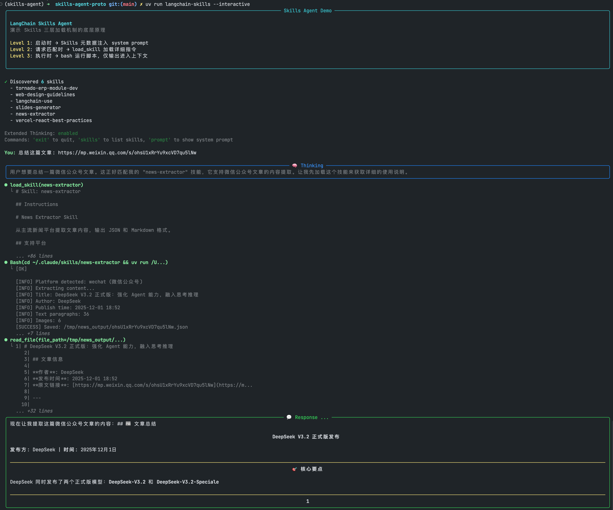

# LangChain Skills Agent

使用 LangChain 1.5 构建的 Skills Agent，演示 Skills 三层加载机制的底层原理。默认接入 DeepSeek（OpenAI 兼容协议），也支持 Anthropic / OpenAI / OpenAI-compatible 接口。

> **B站视频**: [Skills到底怎么实现？我写了个Agent跑给你看](https://www.bilibili.com/video/BV1ZpzhBLE82)

## 特性

- **多 Provider 支持**: 默认 DeepSeek，支持 Anthropic / OpenAI / OpenAI-compatible Base URL
- **思考过程展示**: Anthropic 显示 Extended Thinking；DeepSeek 可选开启思考模式并显示 `reasoning_content`
- **流式输出**: Token 级实时显示响应
- **工具调用可视化**: 显示工具名称、参数、执行结果
- **中间件链**: 模型重试、工具异常兜底、工具重试、人工审批（HITL）、上下文自动摘要
- **三层 Skills 加载**: Level 1 元数据注入 → Level 2 指令加载 → Level 3 脚本执行

## 快速开始

### 1. 安装

```bash
git clone https://github.com/NanmiCoder/skills-agent-proto.git
cd skills-agent-proto
uv sync
```

### 2. 配置模型 API

默认接入 DeepSeek；同时保留 Anthropic / OpenAI-compatible 的接入方式，按需在 `.env` 里切换。

#### DeepSeek（默认）

去 [DeepSeek 开放平台](https://platform.deepseek.com/api_keys) 申请 API Key，然后创建 `.env`：

```bash
MODEL_PROVIDER=deepseek
MODEL_NAME=deepseek-flash
MODEL_API_KEY=sk-xxx
MODEL_BASE_URL=https://api.deepseek.com
```

- `deepseek-flash`：DeepSeek-V4.1-Flash，1M 上下文、最大输出 384K，支持工具调用，速度快、成本低
- `deepseek-v4-pro`：更强的推理版本（不支持图像输入）
- 也可以写成 `MODEL_NAME=deepseek:deepseek-flash`，用 `provider:model` 前缀直接指定 provider
- 思考模式**默认关闭**。需要时设置 `DEEPSEEK_THINKING=true`，并用 `DEEPSEEK_REASONING_EFFORT=low|high|max` 控制强度
  （实验性：开启思考且请求带 tools 时，历史轮的 `reasoning_content` 必须完整回传，否则 DeepSeek API 返回 400）

DeepSeek 的 OpenAI 兼容端点 base URL 就是 `https://api.deepseek.com`，项目不会像对 OpenAI 那样自动补 `/v1`。

#### Anthropic（可选）

```bash
MODEL_PROVIDER=anthropic
MODEL_NAME=claude-sonnet-4-5-20250929
MODEL_API_KEY=sk-xxx
MODEL_BASE_URL=https://api.jiekou.ai/anthropic
```

兼容旧配置，下面这些变量仍然可用：

```bash
ANTHROPIC_AUTH_TOKEN=sk-xxx
ANTHROPIC_BASE_URL=https://api.jiekou.ai/anthropic
CLAUDE_MODEL=claude-sonnet-4-5-20250929
```

#### OpenAI / OpenAI-compatible（可选）

```bash
MODEL_PROVIDER=openai
MODEL_NAME=gpt-5.4
MODEL_API_KEY=sk-xxx
MODEL_BASE_URL=https://api.jiekou.ai/openai
```

开启 OpenAI thinking 时，项目默认会走 Responses API，并自动把上面的 base URL 规范成 `https://api.jiekou.ai/openai/v1`，这样 `gpt-5.4` 的 reasoning 和 tool calling 可以同时工作。

也支持 OpenAI 专属变量：

```bash
OPENAI_API_KEY=sk-xxx
OPENAI_BASE_URL=https://api.jiekou.ai/openai
OPENAI_MODEL=gpt-5.4
OPENAI_REASONING_EFFORT=medium
```

如果你的代理只支持 `chat/completions`，可以显式关闭：

```bash
OPENAI_USE_RESPONSES_API=false
```

这种模式下 `MODEL_BASE_URL` / `OPENAI_BASE_URL` 可以填到兼容服务的 base 层级，例如 `https://api.jiekou.ai/openai` 或 `https://api.jiekou.ai/openai/v1`。如果误填到完整 endpoint，例如 `.../v1/chat/completions`，项目会自动裁剪回 SDK 需要的 `.../v1`，避免重复拼接路径。

### 3. 交互式验证

```bash
uv run langchain-skills --interactive
```

启动后会显示当前实际使用的 `provider:model`，方便确认是否已经切到 DeepSeek。

## 三层加载演示



启动后可以观察到完整的三层加载过程：

### Level 1: 启动时 - 元数据注入

```
✓ Discovered 6 skills
  - tornado-erp-module-dev
  - web-design-guidelines
  - news-extractor
  ...
```

Skills 的 name + description 已注入 system prompt，模型知道有哪些能力可用。

### Level 2: 请求匹配时 - 指令加载

```
You: 总结这篇文章 https://mp.weixin.qq.com/s/ohsU1xRrYu9xcVD7qu5lNw

● load_skill(news-extractor)
  └ # Skill: news-extractor
    ## Instructions
    从主流新闻平台提取文章内容...
```

用户请求匹配到 skill 描述，模型主动调用 `load_skill` 获取完整指令。

### Level 3: 执行时 - 脚本运行

```
● Bash(uv run .../extract_news.py https://mp.weixin.qq.com/s/ohsU1xRrYu9xcVD7qu5lNw)
  └ [OK]
    [SUCCESS] Saved: output/xxx.md
```

模型根据指令执行脚本，**脚本代码不进入上下文，只有输出进入**。

## 中间件（middleware）

中间件挂在 `create_agent` 编译出的 LangGraph 图上，在"模型调用 / 工具执行"前后插入通用逻辑。
本项目在 `agent.py::_build_middleware()` 里按下面顺序装配：

| 顺序 | 中间件 | 作用 | 开关 |
|------|--------|------|------|
| 0 | `_route_by_intent`（`@wrap_model_call`） | 按意图决定本轮是否启用 `AgentReply` 结构化输出：任务型保留，聊天型覆盖为 `None` | `SKILLS_INTENT_ROUTER=false` 关闭 |
| 1 | `ModelRetryMiddleware` | 模型调用失败（网络 / 429 / 5xx）指数退避重试 2 次 | 固定 |
| 2 | `ToolErrorMiddleware` | 工具抛异常时转成 `[FAILED] 工具名 raised 异常类型: 信息` 的 ToolMessage，避免整个 agent 崩掉 | 固定 |
| 3 | `HumanInTheLoopMiddleware` | 执行 `bash` / `write_file` 前暂停，等人工批准 / 拒绝 / 修改参数 | `SKILLS_HITL=false` 关闭 |
| 4 | `ToolRetryMiddleware` | 工具失败重试 2 次，`on_failure="error"` 交回外层兜底 | 固定 |
| 5 | `SummarizationMiddleware` | 历史超过阈值 token 时，用独立摘要模型压缩旧消息 | `SKILLS_SUMMARY_TRIGGER_TOKENS=0` 关闭 |

顺序不是随意的：

- `ToolErrorMiddleware` 必须在 `ToolRetryMiddleware` 外层。重试耗尽后 `ToolRetry` 抛出异常，正好被 `ToolError` 接住转成 ToolMessage；顺序反了，异常会被重试层直接抛出，模型看不到失败原因。
- `HumanInTheLoopMiddleware` 在重试层外层，审批只做一次，不会因为重试反复询问。
- `SummarizationMiddleware` 放最后：前面的中间件已经把请求处理干净，摘要只关心历史长度。

摘要使用独立模型实例（`_build_summarizer_model()`）：温度 0.2、`max_tokens=2000`、关闭 DeepSeek 思考模式。
不复用主模型，是因为主模型可能开着思考（多花钱，且触发 `reasoning_content` 回传规则）。

### 人工审批（HITL）怎么用

CLI 交互模式或单次执行时，模型一旦要调用 `bash` / `write_file`，会先停下来：

```
● 工具执行需要确认
  bash  {"command": "rm -rf build"}
  批准? (a / r / e):
```

- `a` 批准执行
- `r` 拒绝（可附一句原因，模型会据此调整）
- `e` 修改参数后再执行（输入新的 JSON）

Web 端走同一套事件协议，中断时 `/api/chat/stream` 直接返回一条扁平结构的 `event: interrupt`（**本轮不再发 `done`**）：

```
event: interrupt
data: {"type": "interrupt", "interrupts": [{"id": "...", "value": {"action_requests": [{"name": "bash", "args": {"command": "..."}}], "review_configs": [...]}}]}
```

前端收到后渲染审批卡片（`web/src/components/ApprovalCard.tsx`），用户点击“批准并继续 / 拒绝”后调用
`POST /api/chat/resume`（body：`{"thread_id": "...", "decisions": [{"type": "approve"}]}`）恢复执行；
`web/src/lib/sse.ts` 在收到 `interrupt` / `done` / `error` 任一终止事件时关闭连接，避免浏览器自动重连重放请求。

### 意图路由：任务型才结构化输出

同一句提问，可能是"帮我干活"，也可能只是"聊两句"。本项目用**规则快判 + 小模型分类**做意图路由：

1. `_classify_by_rules()` 先用关键词判断（"帮我创建…"→任务型；"什么是…/解释一下…"→聊天型）；拿不准返回 `None`。
2. 拿不准时调用分类模型 `_build_classifier_model()`（温度 0、关闭思考、`max_tokens=300`），
   用 `with_structured_output(Intent, method="function_calling")` 得到 `is_task` 与理由；失败则保守按聊天型处理。
   （必须指定 `function_calling`：DeepSeek 不支持 `json_schema` 形式的 `response_format`。）
3. 结果写进本轮上下文 `SkillAgentContext.task_mode`，并由 `_route_by_intent` 中间件决定是否保留
   `response_format=AgentReply`：任务型保留，聊天型覆盖为 `None`。

任务型轮次的最后，模型会"调用" `AgentReply` 交卷（框架拦截、不会真正执行），结果在
`result["structured_response"]`：

```python
{
    "summary": "已创建 hello.txt 并写入 hi",
    "needs_followup": False,
    "followup_reason": None,
}
```

事件流里会先出现一条 `{"type": "intent", "data": {"is_task": true, "source": "rule", "reason": "..."}}`，
方便前端/日志观察判定结果（`source` 取值：`rule` / `llm` / `fallback` / `disabled`）。
任务型轮次的最后一条 `done` 事件会带上 `structured` 字段（`AgentReply` 的内容），
聊天型轮次没有该字段，也不会把同一 thread 上一轮的结构化结果串进来。

> 关闭方式：`.env` 里设 `SKILLS_INTENT_ROUTER=false`，此时一律按聊天型处理（不启用结构化输出）。

## 长期记忆（跨会话）

`checkpointer` 管的是"单个 thread 内的对话历史"，进程退出就没了；**长期记忆是另一套存储**：

| | checkpointer（短期） | store（长期） |
|---|---|---|
| 作用域 | 单个 `thread_id` | 跨 thread / 跨会话 |
| 存什么 | 完整消息历史 | 提炼后的事实、偏好 |
| 本项目实现 | `InMemorySaver` | `InMemoryStore` + `remember` / `recall` 工具 |
| 生产建议 | `SqliteSaver` / `PostgresSaver` | `PostgresStore` / `RedisStore` |

本次实现（见 `src/langchain_skills/tools.py`）：

1. `create_agent(..., store=store)` 把 store 挂到 agent 上；
2. 工具里通过 `runtime.store` 读写，namespace 为 `("memories", user_id)`，不同用户天然隔离；
3. `remember(content)` 写入一条原子事实（key 带时间戳+随机后缀，不覆盖旧记忆）；
4. `recall(query)` 检索：中文按二元组、英文按词做关键词召回，未命中则返回最近记忆
   （没有配 embedding 索引，所以是"关键词 + 最近"而不是向量语义检索）；
5. 用户身份来自 `SKILLS_MEMORY_USER`（默认 `local-user`）。

演示"跨会话"要注意：**`InMemoryStore` 是进程内的**，所以要在同一个后端进程里换 `thread_id`：

```bash
# thread A：写入记忆
curl.exe -N "http://127.0.0.1:8000/api/chat/stream?message=记住：我偏好用Java，不用Python&thread_id=mem-a"

# thread B：新会话，检索记忆
curl.exe -N "http://127.0.0.1:8000/api/chat/stream?message=我偏好用什么语言？&thread_id=mem-b"
```

Web 页面上就是"新建会话"后再问——同一个后端进程内记忆是共享的。
重启后端进程记忆会清空；要跨进程保留，把 `_build_store()` 换成持久化 store 即可。

## RAG 知识库（离线索引流水线）

RAG 分四段：**① 加载与质检 → ② 切分 → ③ 向量化写入向量库 → ④ 接入 Agent**。当前已完成 ① ② ③ ④：

| 步骤 | 脚本 / 位置 | 输入 | 输出 |
|---|---|---|---|
| ① 加载质检 | `scripts/inspect_docs.py` | `knowledge/` 下的 md/txt/pdf | `.rag/extracted/` + `.rag/extraction_report.json` |
| ② 切分 | `scripts/inspect_chunks.py` | 同上（直接读原文） | `.rag/chunks/*.jsonl` + `.rag/chunks_report.json` |
| ③ 向量化 | `scripts/build_rag_index.py` | `.rag/chunks/` | Chroma（docker 服务 + `.rag/chroma` 数据目录）+ `.rag/index_manifest.json` |
| ③ 检索验证 | `scripts/search_docs.py` | 一句话 | top-k chunk（带 source/section/score） |
| ④ 接入 Agent | `src/langchain_skills/tools.py` 的 `search_docs` 工具 | 用户自然语言问题 | agent 自主检索，chunk 作为 ToolMessage 进入上下文 |

**原始资料 vs 生成物**：`knowledge/` 进 git（Source of Truth）；`.rag/` 全部是生成物，已在 `.gitignore` 中，删掉可随时重建。

### ① 加载与质检

```bash
uv run python scripts/inspect_docs.py
```

按篇打印页数/字符数/编码，检查四类问题（阈值见 `scripts/rag_loader.py`）：空页率 > 20%（扫描版 PDF）、重复行率 > 30%（页眉页脚）、乱码率 > 0.1%（编码/字体）、平均每页 < 50 字符（抽不出文字）。

### ② 切分

```bash
# 默认 chunk_size=500、overlap=100（≈20%）
uv run python scripts/inspect_chunks.py

# 自定义参数、每篇多看几个样本
uv run python scripts/inspect_chunks.py --chunk-size 700 --overlap 120 --samples 3
```

切分规则：

1. Markdown 先按 `#` / `##` / `###` 切（`MarkdownHeaderTextSplitter`），保住章节语义；
2. 过长的章节再用 `RecursiveCharacterTextSplitter` 按中文标点递归切，相邻 chunk 保留 overlap，避免一句话被切断；
3. 每个 chunk 的正文前拼上**章节路径**（如 `退换货政策 > 退货流程`），单独召回时模型也知道上下文；
4. PDF 按页切，chunk 记录 `page_start`，回答时可标注页码。

JSONL 每行一个 chunk：`{id, text, source, title, chunk_index, section, page_start, metadata}`。`chunks_report.json` 记录切分参数与长度分布——**参数一变，向量索引就必须重建**。

### ③ 向量化与检索验证

**为什么用 Docker 跑 Chroma**：本机 Chroma 的嵌入式 `PersistentClient` 打不开本地持久化库（Rust SQLite 后端报 `code: 14 unable to open database file`），而 `HttpClient` 连接 Chroma 服务正常。所以用官方镜像起一个常驻服务，数据落在 `.rag/chroma`（docker volume 挂载）。

```bash
# 1) 启动 Chroma 服务（只需一次；restart unless-stopped 会跟随 Docker 启动）
docker compose up -d chroma
docker ps                      # 应看到 skills-agent-chroma，127.0.0.1:8100->8000

# 2) 构建索引（参数与 chunk hash 都没变会自动跳过，不花 embedding 费用）
uv run python scripts/build_rag_index.py
uv run python scripts/build_rag_index.py --force    # 强制重建

# 3) 检索验证
uv run python scripts/search_docs.py --query "退货要多久才能退款？"
uv run python scripts/search_docs.py --query "token 有效期多久？" --top-k 3 --json
```

环境变量（`.env`，说明见 `.env.example`）：`ZHIPU_API_KEY`、`RAG_EMBEDDING_MODEL=embedding-3`、`RAG_EMBEDDING_DIMENSIONS=1024`、`RAG_CHROMA_HOST=127.0.0.1`、`RAG_CHROMA_PORT=8100`。

**重建判定（`.rag/index_manifest.json`）**：manifest 记录 embedding 模型/维度、chunk_size/overlap、collection 名、每个 chunk 文件的 sha256 和 token 用量。任一不同、或 Chroma 里条数与 chunk 数不一致、或传 `--force` → 删旧 collection 全量重建；全部一致 → 直接跳过。

**实测开销**：8 个 chunk、565 tokens、1 次请求、约 **0.00028 元**（embedding-3 按 0.5 元/百万 tokens）。示例文档下几乎可忽略；真实语料按 1 万 chunks × 200 tokens ≈ 200 万 tokens ≈ 1 元/次全量重建。

**注意**：换 embedding 模型或维度必须重建（Chroma 的 collection 维度固定）；Chroma 服务是单写者，构建索引请在单机离线做，运行期只读检索。

### ④ 接入 Agent（`search_docs` 工具）

前三步是"离线建库"，这一步把检索接成 agent 的一个工具，形成 **Agentic RAG** 闭环：

```
用户提问 → 模型决定调 search_docs(query) → Chroma 检索 top-k
        → chunk 作为 ToolMessage 回填 → 模型基于资料回答并标注 source
```

```bash
# 不需要额外命令，agent 自带该工具
uv run langchain-skills "退货后多久能退款？请引用来源"
```

行为要点：

- **工具描述写"何时用"**：面向政策、退款、错误码、产品规则等文档型问题；模型会自己判断要不要查；
- **返回带出处**：`source` / `section` / `page`，模型据此标注来源；检索为空时返回 `[OK] No relevant documents found...`，引导模型承认"知识库没覆盖"而不是编造；
- **只读工具**：不在 `bash` / `write_file` 的 HITL 审批名单里，不会打断自动化；
- **惰性连接**：首次调用才连 Chroma + 初始化智谱 embedding，不拖慢 agent 启动；服务没起时返回 `[FAILED] ... docker compose up -d chroma` 提示，而不是抛异常；
- **上下文控制**：默认 top-k=4（上限 10），每个 chunk 截断 500 字符，避免一次塞爆上下文。

实现上 `tools.py` 复用 `scripts/` 里同一套 embedding / Chroma 代码（`importlib` 按需加载），保证"脚本验证"和"agent 使用"走的是同一条检索链路，不会出现两份逻辑。

实测（示例知识库）：

```
● search_docs(query=退货后多久能退款 退款到账时间)
  └ [OK] Found 4 relevant chunk(s) ...
    [1] score=0.8134 source=product/faq.md section=退换货政策常见问题 > 退货流程
→ 回答中标注「来源：product/faq.md — 退换货政策 > 退货流程」，
  并主动说明"其它支付渠道知识库未覆盖，建议咨询客服"
```

## CLI 命令

```bash
# 交互式模式（推荐）
uv run langchain-skills --interactive

# 单次执行
uv run langchain-skills "列出当前目录"

# 禁用 Thinking（降低延迟；DeepSeek 默认就是关闭状态）
uv run langchain-skills --no-thinking "执行 pwd"

# 查看发现的 Skills
uv run langchain-skills --list-skills

# 查看 System Prompt（Level 1 注入内容）
uv run langchain-skills --show-prompt
```

## Web Demo（React + FastAPI + SSE）

### 一键启动（推荐）

```bash
./start.sh
```

脚本会自动执行：
- `uv sync`（后端依赖安装）
- `web/npm install`（前端依赖安装）
- 启动 FastAPI（8000）和 Vite（5173）

### 1. 启动后端 API（端口 8000）

```bash
uv run langchain-skills-web
```

等价命令：

```bash
uv run uvicorn langchain_skills.web_api:app --reload --port 8000
```

### 2. 启动前端（端口 5173）

```bash
cd web
npm install
npm run dev
```

默认会连接 `http://localhost:8000`，如需修改：

```bash
VITE_API_BASE_URL=http://127.0.0.1:8000 npm run dev
```

### 3. Web 交互能力

- 打开页面即显示已发现 Skills（name / description / path）
- 底部输入框支持多轮对话和手动新建 thread
- SSE 实时显示 `thinking`、`tool_call`、`tool_result`、`text`、`done`、`error`、`interrupt`
- 当调用 `load_skill` 时，UI 会明确标记当前识别到的 skill
- 工具人工审批：收到 `interrupt` 事件后渲染审批卡片，点击“批准并继续 / 拒绝”调用
  `POST /api/chat/resume`，恢复后的流继续渲染到同一个回答气泡里
- 任务型提问会展示结构化结果（`done.structured`），聊天型提问保持普通文本
- 支持命令：
  - `/skills` 显示可用技能列表
  - `/prompt` 显示当前 system prompt

## 项目结构

```
skills-agent-proto/
├── src/langchain_skills/
│   ├── agent.py          # LangChain Agent（provider 路由 + middleware 链 + HITL resume）
│   ├── cli.py            # CLI 入口（流式输出 + 工具审批交互）
│   ├── web_api.py        # FastAPI + SSE（含 /api/chat/resume）
│   ├── tools.py          # 工具定义 (load_skill, bash, read/write_file, glob, grep, edit, list_dir, remember, recall, search_docs)
│   ├── skill_loader.py   # Skills 发现和加载
│   └── stream/           # 流式处理模块
│       ├── emitter.py    # 事件发射器
│       ├── tracker.py    # 工具调用追踪（支持增量 JSON）
│       ├── formatter.py  # 结果格式化器
│       └── utils.py      # 常量和工具函数
├── tests/                # 单元测试
│   ├── test_stream.py
│   ├── test_cli.py
│   └── test_tools.py
├── web/                  # React + Vite 前端
│   └── src/
│       ├── App.tsx       # 页面壳 + 发送/审批决策编排
│       ├── components/   # ChatTimeline / ApprovalCard / Composer / SkillPanel / ToolCallItem
│       ├── lib/sse.ts    # /api/chat/stream 与 /api/chat/resume 的 SSE 客户端
│       └── state/        # chatReducer（含 interrupt / awaiting_approval 状态机）
├── docs/                 # 文档
│   ├── skill_introduce.md
│   └── langchain_agent_skill.md
├── knowledge/            # RAG 原始资料（进 git，按业务域分目录）
│   ├── api/
│   └── product/
├── scripts/              # RAG 离线脚本
│   ├── rag_loader.py     # ① 加载 + 质检
│   ├── inspect_docs.py   # ① 命令行入口
│   ├── rag_splitter.py   # ② 切分
│   ├── inspect_chunks.py # ② 命令行入口
│   ├── rag_embeddings.py # ③ 智谱 embedding 适配器（httpx，64 条/批、429 退避）
│   ├── build_rag_index.py# ③ 建索引 + manifest（跳过/重建判定）
│   └── search_docs.py    # ③ 检索验证
├── docker-compose.yml    # 本地 Chroma 服务（第③步，127.0.0.1:8100）
├── .rag/                 # RAG 生成物（gitignore：抽取文本、chunk、向量索引）
└── .claude/skills/       # 示例 Skills
    └── news-extractor/
        ├── SKILL.md
        └── scripts/extract_news.py
```

## Skills 三层加载机制

| 层级 | 时机 | Token 消耗 | 内容 |
|------|------|------------|------|
| **Level 1** | 启动时 | ~100/Skill | YAML frontmatter (name, description) |
| **Level 2** | 触发时 | <5000 | SKILL.md 完整指令 |
| **Level 3** | 执行时 | 仅输出 | 脚本执行结果（代码不进上下文） |

## 运行测试

```bash
uv run python -m pytest tests/ -v
```

## 环境变量

| 变量 | 说明 | 默认值 |
|------|------|--------|
| `MODEL_PROVIDER` | 通用 provider，`deepseek` / `anthropic` / `openai` | `deepseek` |
| `MODEL_NAME` | 通用模型名 | `deepseek-flash` |
| `MODEL_API_KEY` | 通用 API Key / 平台 Token | 无 |
| `MODEL_BASE_URL` | 通用 Base URL | DeepSeek 官方 |
| `DEEPSEEK_API_KEY` | DeepSeek 专属 API Key | 无 |
| `DEEPSEEK_AUTH_TOKEN` | DeepSeek 专属 Token（同 KEY） | 无 |
| `DEEPSEEK_BASE_URL` | DeepSeek Base URL | `https://api.deepseek.com` |
| `DEEPSEEK_MODEL` | DeepSeek 专属模型名 | `deepseek-flash` |
| `DEEPSEEK_THINKING` | 是否开启 DeepSeek 思考模式 | `false` |
| `DEEPSEEK_REASONING_EFFORT` | DeepSeek 思考强度 `low` / `high` / `max` | `high` |
| `ANTHROPIC_AUTH_TOKEN` | Anthropic 兼容旧配置 | 无 |
| `ANTHROPIC_BASE_URL` | Anthropic Base URL | 官方 API |
| `CLAUDE_MODEL` | Anthropic 兼容旧模型变量 | `claude-opus-4-5-20251101` |
| `OPENAI_API_KEY` | OpenAI API Key | 无 |
| `OPENAI_BASE_URL` | OpenAI / 兼容接口 Base URL | 官方 API |
| `OPENAI_MODEL` | OpenAI 模型名 | `gpt-5-mini` |
| `OPENAI_REASONING_EFFORT` | OpenAI thinking 强度 | `medium` |
| `OPENAI_USE_RESPONSES_API` | 是否使用 Responses API | `true` |
| `SKILLS_HITL` | 是否开启 `bash` / `write_file` 人工审批 | `true` |
| `SKILLS_INTENT_ROUTER` | 是否开启意图路由（任务型才结构化输出），关闭后一律按聊天型 | `true` |
| `SKILLS_CLASSIFIER_MODEL` | 意图分类用的模型名（默认复用主模型，可换更便宜的模型） | 同 `MODEL_NAME` |
| `SKILLS_MEMORY_USER` | 长期记忆归属的用户 ID（namespace 隔离用） | `local-user` |
| `SKILLS_SUMMARY_TRIGGER_TOKENS` | 触发上下文摘要的历史 token 阈值，`0` 关闭 | `8000` |
| `SKILLS_SUMMARY_KEEP_MESSAGES` | 摘要后保留的最近消息条数 | `20` |
| `MAX_TOKENS` | 最大输出 tokens | `16000` |
| `MODEL_TEMPERATURE` | 模型温度 | `1.0` |
| `RAG_DOCS_DIR` | RAG 原始资料目录 | `knowledge` |
| `RAG_CHUNK_SIZE` | 每个 chunk 最大字符数 | `500` |
| `RAG_CHUNK_OVERLAP` | 相邻 chunk 重叠字符数 | `100` |
| `RAG_CHUNKS_DIR` | 切分产物目录 | `.rag/chunks` |
| `RAG_INDEX_DIR` | 向量索引在宿主机上的位置（docker 挂载目录，仅说明用） | `.rag/chroma` |
| `RAG_COLLECTION` | Chroma collection 名 | `knowledge` |
| `RAG_CHROMA_HOST` | Chroma 服务地址（第③步） | `127.0.0.1` |
| `RAG_CHROMA_PORT` | Chroma 服务端口 | `8100` |
| `RAG_CHROMA_SSL` | Chroma 是否走 HTTPS | `false` |
| `ZHIPU_API_KEY` | 智谱 API Key（第③步 embedding 使用） | 无 |
| `RAG_EMBEDDING_MODEL` | 智谱 embedding 模型名 | `embedding-3` |
| `RAG_EMBEDDING_DIMENSIONS` | 向量维度（`embedding-3` 可选 256/512/1024/2048） | `1024` |
| `RAG_EMBEDDING_BATCH_SIZE` | 每批 embedding 条数（智谱上限 64） | `64` |
| `RAG_EMBEDDING_TIMEOUT` | embedding 请求超时（秒） | `30` |
| `RAG_EMBEDDING_MAX_RETRIES` | 429/5xx 重试次数 | `3` |

> 建议优先使用 `MODEL_*` 通用变量；这样在 DeepSeek / Anthropic / OpenAI 之间切换时只需要改 provider、model、base_url。

## 参考文档

- [docs/skill_introduce.md](./docs/skill_introduce.md) - Skills 详细介绍
- [docs/langchain_agent_skill.md](./docs/langchain_agent_skill.md) - LangChain 实现说明
- [LangChain ChatOpenAI](https://docs.langchain.com/oss/python/integrations/chat/openai) - OpenAI 集成
- [LangChain Models / base_url](https://docs.langchain.com/oss/python/langchain/models) - OpenAI-compatible Base URL 配置
- [DeepSeek API 文档](https://api-docs.deepseek.com/) - DeepSeek 官方接口说明
- [DeepSeek 模型与价格](https://api-docs.deepseek.com/quick_start/pricing) - 模型列表与定价

## License

MIT
